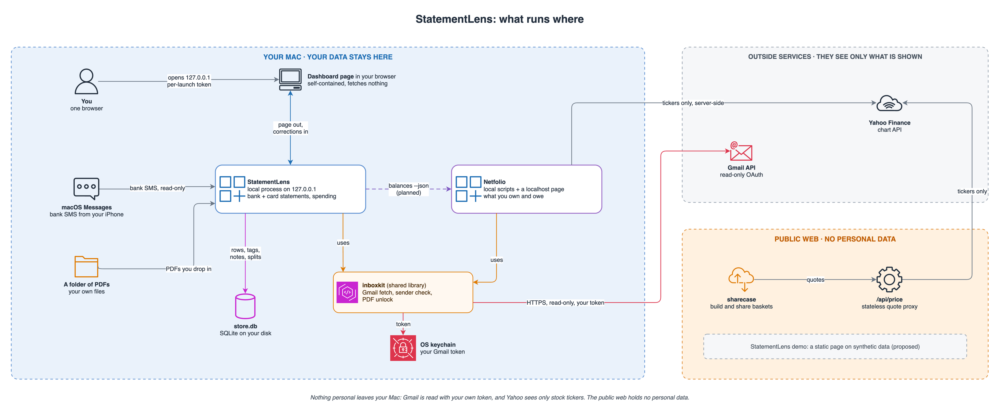
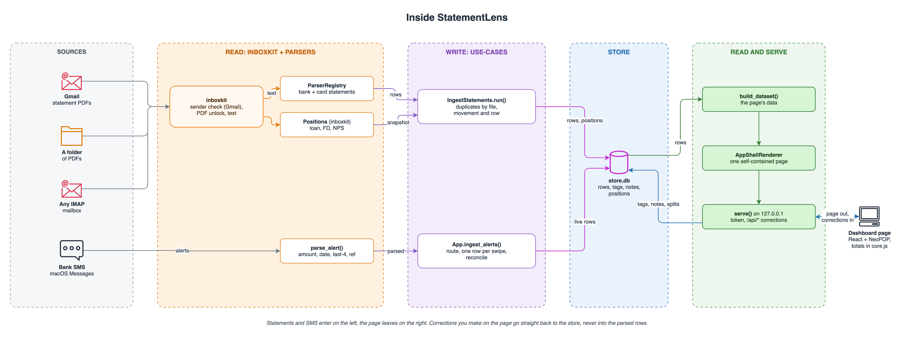
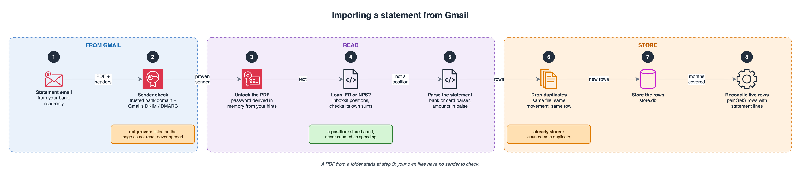
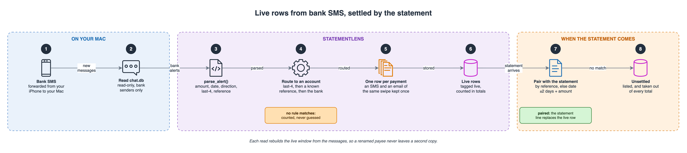
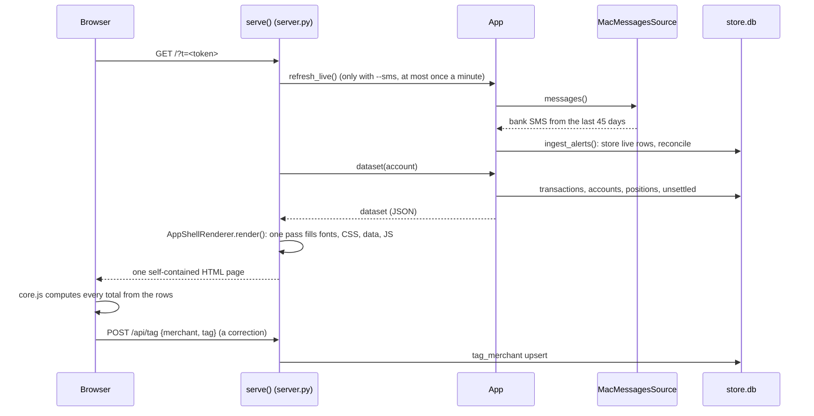
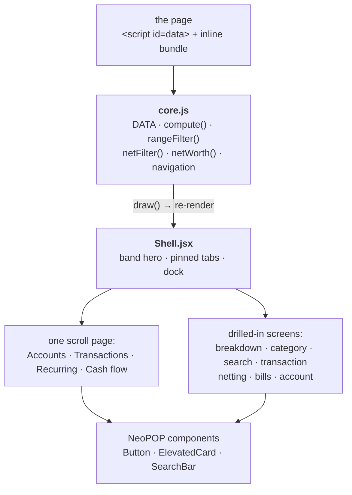
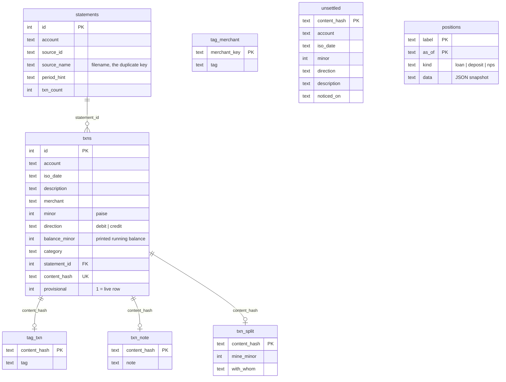
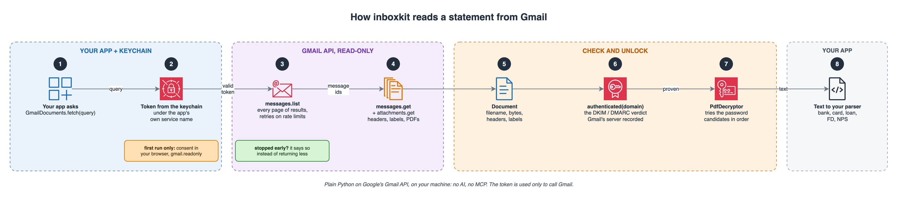

# StatementLens architecture

StatementLens reads the bank, card, loan, deposit and pension documents you already receive (by email,
in a folder, or as bank SMS on a Mac), parses them on your machine, and serves one dashboard from a local
server. Nothing is sent anywhere. This document describes how the app works; it contains no real data.

The big-picture diagrams (sections 1 to 4, 10 and 11) are draw.io: each PNG sits next to its editable
`.drawio` file in [`docs/architecture/`](architecture/), and `gen_drawio.py` there regenerates all of them.
The detailed ones (the page-load sequence, the page, the store) are Mermaid, rendered by GitHub, with SVG
copies in the same folder. Labels use the real module and function names, so a rename shows up here as a
stale label in review.

Reading order for an engineer: sections 1 and 2 for the shape, 10 for what runs where, 11 for the shared
Gmail/PDF layer, then 3 to 6 for the data path, and 7 for how every number is computed.

## 1. Context



## 2. Containers



| Container | Does | Its data comes from |
|---|---|---|
| Sources | Fetch documents: statement PDFs (Gmail, folder, IMAP) and bank SMS; alert-email readers are built but not called yet | the mailbox, a folder, `chat.db` |
| Unlock | Opens password-protected PDFs by trying candidates derived in memory from your hints (name, date of birth, mobile, card last 4, PAN) | hints passed at run time, never written to disk |
| Parse | Bank and card statements become transactions; loan, FD and NPS documents become positions; alerts become live rows | the unlocked text |
| Use-cases | Ingest with duplicate protection; live alerts routed, de-duplicated and reconciled; the dataset the page needs | the store |
| Store | SQLite: statements, transactions, corrections, positions, unreconciled live rows | written by the use-cases |
| Serve | A stdlib HTTP server on 127.0.0.1 behind a per-launch token; renders the page and takes corrections | the dataset |
| Dashboard | One React app on CRED's NeoPOP components, built once and committed, so installing needs no Node | the page's embedded JSON |

The **Unlock** box, the password rules, the keychain store, the Gmail fetch and the loan / FD / NPS
parser are generic, so they come from [inboxkit](https://github.com/udaysrinu/inboxkit), a library shared
with other apps (section 11), pinned to a tag in `pyproject.toml`. StatementLens's own modules for them
are one-line re-exports, so nothing else in the code had to change.

### What lives where

| Place | Holds |
|---|---|
| `store.db` | everything parsed, plus your tag corrections, notes and splits (kept separate so a re-import never undoes them) |
| `store.sync.json` | when the last sync ran and what it skipped |
| `store.prefs.json` | small preferences: who to net with, your name for the header |
| OS keychain | the Gmail OAuth token |
| browser `localStorage` | the theme and the privacy lock, nothing else |

## 3. Ingesting a statement



A position (loan, deposit, pension) is never booked as transactions: every EMI and every FD funding is
already a debit on the account that paid it, so booking the document as well would count it twice.

## 4. Live rows and reconciliation



## 5. Serving the dashboard



### The page



## 6. The store



Corrections (`tag_*`, `txn_note`, `txn_split`) key on `content_hash`, not on `txns.id`, so they survive a
statement being re-imported.

## 7. How the numbers are calculated

| Number | Rule |
|---|---|
| Every amount | integer paise end to end; never a float |
| Money in / out / invested | `compute()` over the period's rows; self-transfers and card bill payments are left out of both sides |
| A breakdown's lines | sum exactly to its headline; small sources fold into "Other (N sources)" |
| "Skip refunded" | drops cancelled pairs (left and came straight back), only when both legs are in the period |
| "Settle up friends" | additionally nets people money moved both ways with; a preference, never the default |
| "My share" | uses your share of split charges; the billed amount itself never changes |
| Total balance | the newest printed running balance of each bank account; cards print none |
| Net worth | bank balances + deposits (principal) + NPS value − loans outstanding, from what is tracked. Moving to Netfolio (section 10); StatementLens will hand it balances |
| NPS | value, contributed and gain as the statement prints them, after checking gain = value − contributed + withdrawn |
| Live rows | counted until a statement covers their date, then replaced by it; unpaired ones leave the totals |

The browser recomputes every total from the rows; a parity test runs the same `compute()` from
`web/src/core.js` against the server's figures.

## 8. Refresh: automatic vs manual

| What | How it refreshes |
|---|---|
| Bank SMS (live rows) | automatic on each page load when served with `--sms` (at most once a minute), or `statementlens alerts --days N` |
| Alert emails | not yet: the readers exist but nothing calls them |
| Statements, FD advices, NPS statements | `statementlens refresh`, the dashboard's "refresh", or `statementlens ingest` |
| A folder of PDFs | `statementlens ingest --folder <path>` |
| Corrections (tags, notes, splits) | saved immediately on each tap |

## 9. Security notes

- The server listens on `127.0.0.1` only (LAN only with `--phone`) and every request needs the per-launch token.
- The page fetches nothing at runtime: code, fonts, icons and data are inline.
- Placeholders in the page template are filled in one pass, so text from a statement can never inject code
  or data into the page.
- Statement passwords are derived in memory from hints and never stored. The Gmail token lives in the OS
  keychain.
- Gmail and IMAP access is read-only; `chat.db` is opened read-only and only bank senders are read.
- A statement from Gmail is opened only when its sender's domain is on `TRUSTED_SENDERS`
  (`gmail_source.py`, one organisational domain per bank) **and** the DKIM / DMARC verdict Gmail's own
  server recorded proves the mail came from that domain. Anything else, a lookalike sender or a forged
  one, is listed on the page as not read, with the reason. A new bank is one line in that list, added
  once its first statement is confirmed genuine. PDFs imported from a folder have no sender to check.
- The public repository holds no real statements, figures, names or account numbers; screenshots use the
  synthetic demo store.

## 10. What runs where: website, local process, library

One rule decides it: **anything that touches someone's money data or credentials runs on their own
device; anything public and stateless can be a website; shared code is a library, never a service.**

The other pieces document themselves:
[Netfolio](https://github.com/udaysrinu/netfolio/blob/main/ARCHITECTURE.md),
[sharecase](https://github.com/udaysrinu/sharecase/blob/main/docs/ARCHITECTURE.md) and
[inboxkit](https://github.com/udaysrinu/inboxkit/blob/main/ARCHITECTURE.md).


| Piece | Runs as | Why there | As a generic product |
|---|---|---|---|
| StatementLens | a local process (Python, stdlib HTTP server on 127.0.0.1) plus a page in your browser | it holds your Gmail token, statement PDFs and every transaction; the bank SMS feed is a file only your Mac can read | an installable desktop app (pip / pipx today; a signed app with its own window later). Same code, same local store |
| The dashboard page | a static bundle (React + NeoPOP), served by the local process with the data inlined | needs no server of its own, so it works offline and fetches nothing | the same bundle can also run as a **website demo** on synthetic data, or on PDFs a visitor drops in, processed in their browser only |
| [inboxkit](https://github.com/udaysrinu/inboxkit) | a Python library, pinned by tag | fetching and unlocking documents is the same job for every app; a library keeps it on the user's machine | stays a library. Making it a hosted service would collect everyone's mail in one place |
| [Netfolio](https://github.com/udaysrinu/netfolio) (public code, private data) | scripts run in order on your machine (contract notes, then the snapshot, the daily series and the page build) plus a localhost-only page server | holdings and trades now, and it will hold PAN-unlocked documents and the identifiers you want in one place (PRAN, policy and FD numbers): the most sensitive data of all | the same desktop pattern as StatementLens; it is to read StatementLens's balances through the CLI (planned) |
| sharecase | a public website (static pages + one serverless function) | building and sharing a basket needs no personal data | stays a website. The private tracking of your own holdings moves to Netfolio |
| /api/price | a stateless serverless function that proxies Yahoo's chart API; quotes cached 60 s, history 1 h | Yahoo sends no CORS header, so a browser page cannot call it directly. Netfolio calls Yahoo itself, server-side, and its local page server runs its own copy of this function, so it never touches the public one | stays a public, stateless service. It sees tickers and an IP address, never holdings or amounts |

Why not one hosted web app with accounts? Three costs, all avoidable by staying local:
- **Custody.** A server holding users' statements and mailbox tokens makes the operator responsible for
  everyone's financial data, under India's data-protection law (the DPDP Act).
- **Google's restricted-scope review.** Gmail read access is a *restricted* scope. Any app used by more
  than 100 people must pass Google's OAuth verification, and an app that moves that data through its own
  servers must also pass a recurring third-party security assessment. Check Google's current policy
  before launch; it changes.
- **Live SMS can't be hosted at all.** Bank SMS arrive on the phone, iOS lets no app read them, and the
  only readable copy is the Messages database on a Mac.

How products talk to each other: through files and commands on the same machine (`statementlens balances
--json`), never through network APIs between them, so there is no login, port or token to protect. If
sync across devices is ever needed, it should be end-to-end encrypted with a key only the user holds, so a
sync server never sees the data.

The phone today: open the dashboard over the home network (`serve --phone`), or carry a static snapshot
(`statementlens render --out file.html`), which is one self-contained file.

### The contract StatementLens offers other apps

`statementlens balances --json` prints each account's latest balance and exits non-zero if an account's
balance chain breaks, so a misread figure never travels silently:

```json
{"generated_at": "2026-11-20T15:30:00+05:30",
 "accounts": [{"account": "Demo Bank ••1234", "institution": "Demo", "kind": "bank",
               "balance_paise": 380000, "as_of": "2026-10-03", "source": "statement",
               "statement_period_to": "2026-10-03"}]}
```

`balance_paise` is signed: banks print an overdraft without its minus sign, so it is read from the
balance chain, not the last printed number. Cards report `null` until their "Total Amount Due" is parsed.

## 11. How inboxkit works

inboxkit is **not** an AI connector and does not go through Claude or any MCP server. It is ordinary
Python that calls Google's Gmail REST API with Google's own client library (`google-api-python-client`),
on your machine, with a token that only your machine holds. "The Gmail connector" in this README means
this optional piece (`pip install "statementlens[gmail]"`).



inboxkit's own [ARCHITECTURE.md](https://github.com/udaysrinu/inboxkit/blob/main/ARCHITECTURE.md) is the
reference for its modules, the sender-authentication decision flow and the order passwords are tried in.
This section keeps only the path as StatementLens uses it.

Who owns what: Google Cloud holds the OAuth *client* (the app's identity). Your keychain holds the
*token* (your consent). The documents and everything parsed from them stay on your disk.

